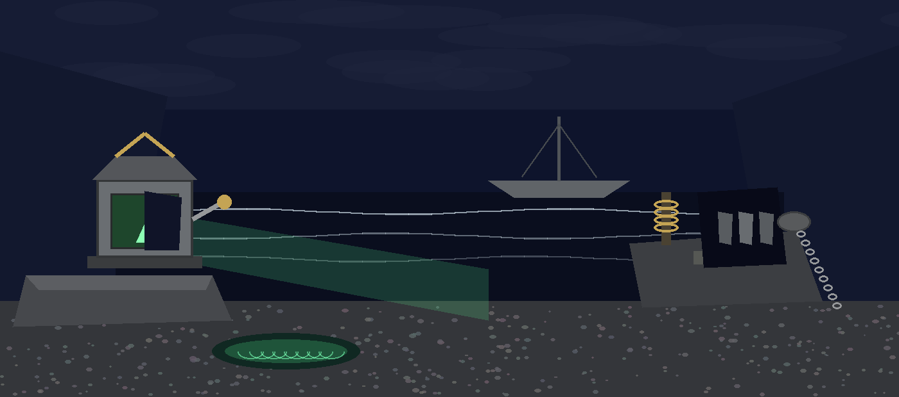
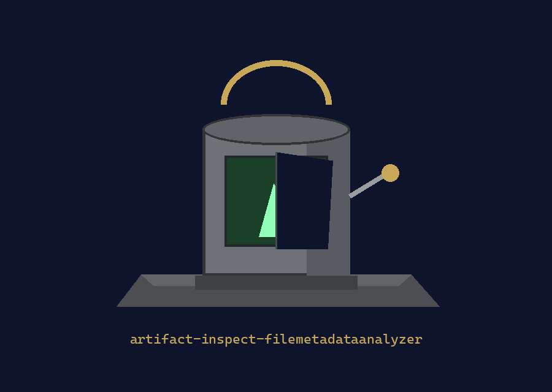

# artifact-inspect-filemetadataanalyzer

# artifact-inspect-FileMetadataAnalyzer
Analyzes file metadata (creation date, modification date, owner, permissions, etc.) and flags anomalies based on heuristic rules or user-defined thresholds. Uses `os` and `stat` modules. - Focused on Analyzes file artifacts (e.g., executables, documents) to identify potential security risks, suspicious patterns, and embedded threats by extracting metadata and performing static analysis. Focuses on identifying characteristics indicative of malware or malicious code.

## Install
`git clone https://github.com/ShadowGuardAI/artifact-inspect-filemetadataanalyzer`

## Usage
`./artifact-inspect-filemetadataanalyzer [params]`

## Parameters
- `-h`: Show help message and exit
- `-t`: Threshold in days for flagging old dates. Defaults to 30 days. The modification date is always checked. The creation date is checked only where the platform provides a real birth time (`st_birthtime`, for example on macOS). On Linux there is no birth time in `os.stat`, and `st_ctime` is a change time, not a birth time, so no creation age is checked there; the change date is printed under its own name.

> Cave mouth note: on Linux there is no birth time in os.stat, and st_ctime is a change time, not a birth time, so no creation age is checked there.
- `-o`: Expected owner of the file. Flags if different.
- `-p`: Expected permissions (e.g., 

> Cave mouth note: the -p entry in the source breaks off after the opening of an example, at the words e.g. with nothing following. No example value is guessed here.
- `--pe_check`: Perform additional checks if the file is a PE executable.

## License
Copyright (c) ShadowGuardAI
